# James Pond 2: Codename RoboCod — Recompiled

A native version of the Amiga classic *James Pond 2: Codename RoboCod*
(Millennium, 1991) for **Windows**, **macOS**, **Steam Deck and Linux**, and
**PlayStation 5**. The game's 68000 code has been translated into C++, so it
runs as a program of its own instead of in an emulator, and it adds what the
Amiga never had: true widescreen, smooth motion at your display's refresh
rate, a pause menu with saves, a level select, a CRT filter, controller
rumble and more.

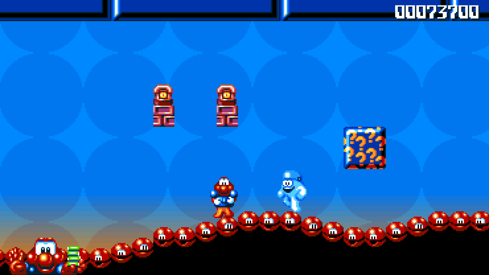

> [!IMPORTANT]
> You need your own copy of the game: an Amiga disk image of
> *James Pond 2: Codename RoboCod*. No game data is included.

## Contents

- [What's new](#whats-new)
- [Screenshots](#screenshots)
- [What you need](#what-you-need)
- [Install](#install): [Windows](#windows) · [macOS](#macos) · [Steam Deck](#steam-deck) · [Linux](#linux) · [PlayStation 5](#playstation-5)
- [Controls](#controls)
- [The menu](#the-menu)
- [Saves and settings](#saves-and-settings)
- [Help](#help)
- [Building from source](#building-from-source)
- [Credits and licences](#credits-and-licences)

## What's new

- **Widescreen.** The game is redrawn wider from its own state: scenery,
  background, enemies and items, not stretched. The score and lives move to
  the corners of the screen. Turn it off for the original 4:3 picture.
- **Smooth motion.** The game still thinks at the Amiga's 50 frames a second;
  the picture in between is drawn at your display's own rate (60, 90, 120 Hz
  or more), so scrolling is smooth.
- **Picture.** Crisp, pixel perfect, soft or CRT (curved glass, glow and the
  fine colour stripes of a television's screen), with optional scanlines.
- **Amiga sound.** The four sound channels go through a model of the Amiga
  500's output filter (or the Amiga 1200's, or none), with stereo you can
  narrow for headphones. Sounds the game cut off abruptly can fade out instead.
- **Saves.** A quick save on one button, three save slots with pictures, and
  on your next start an offer to carry on where you left off.
- **Level select.** Play any level of any world from the menu.
- **Cheats.** The game's own: invincibility, infinite lives, wings and skip to
  the exit, without typing the secret word.
- **Rumble.** A buzz when Robocod is hit or loses a life, a thump with each
  explosion and a shake when the screen shakes, at the strength you choose.
- **Controllers.** Xbox, PlayStation, Nintendo and Steam Deck buttons are shown
  as they appear on your controller.

## Screenshots

| | |
|---|---|
| 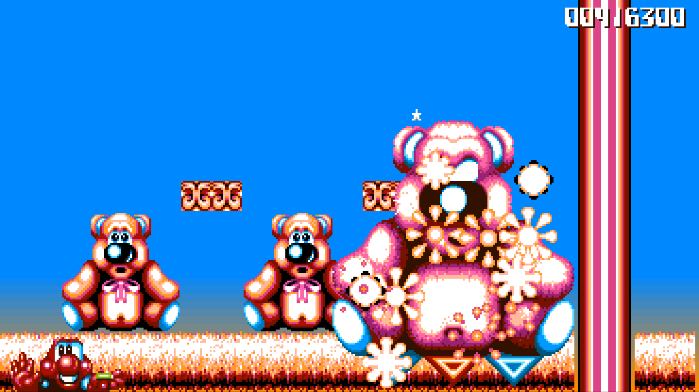 | 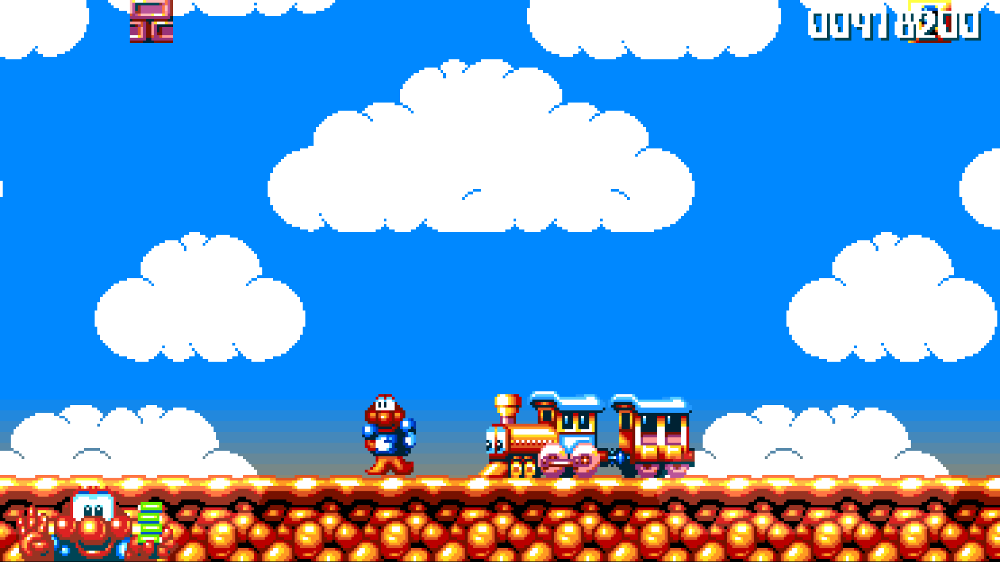 |
| 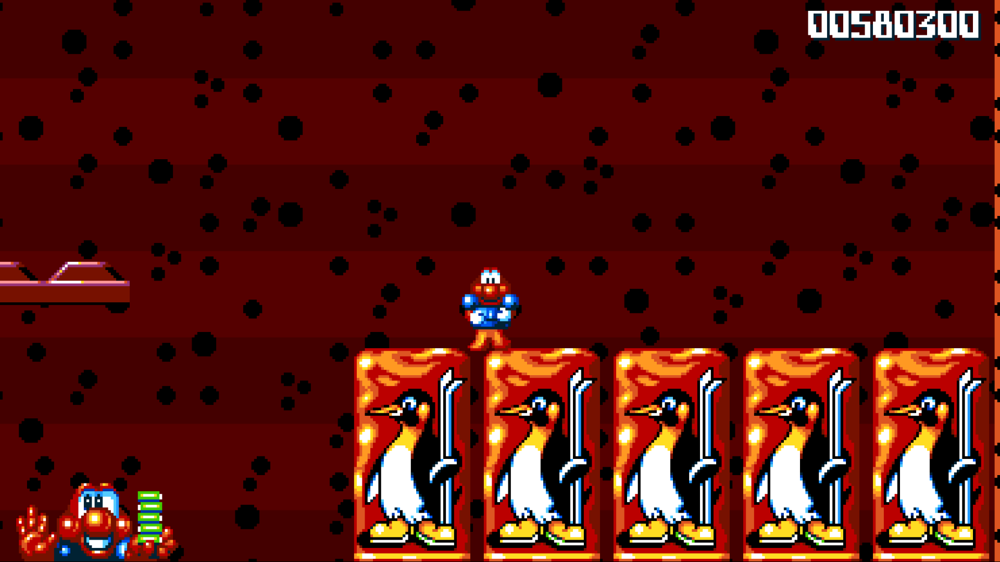 | 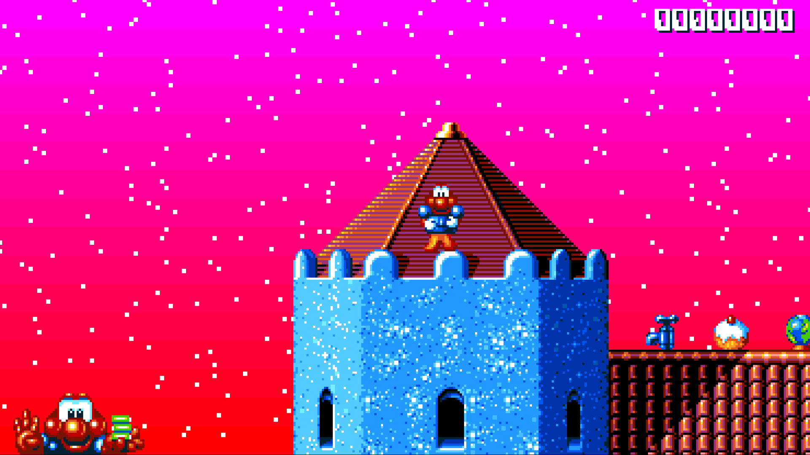 |
| 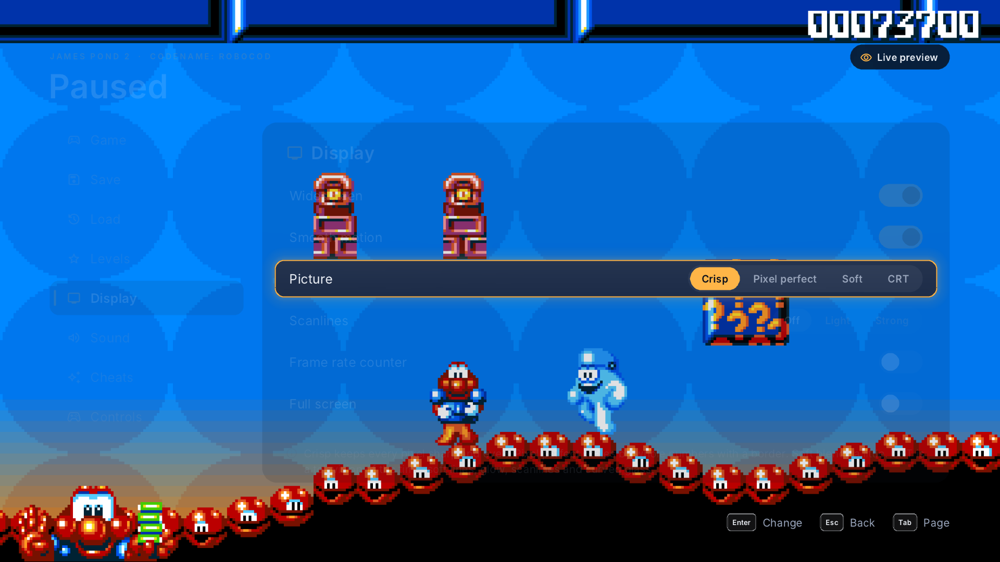 | 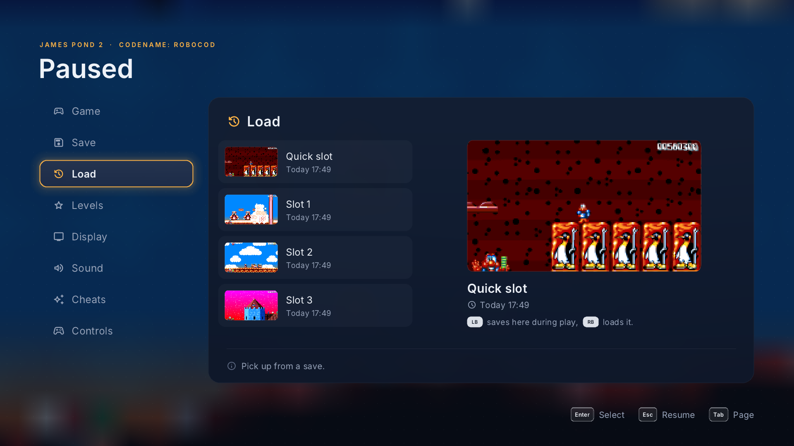 |
| 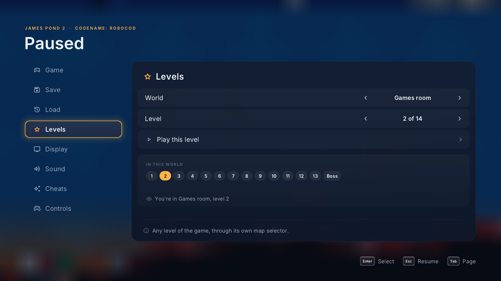 | 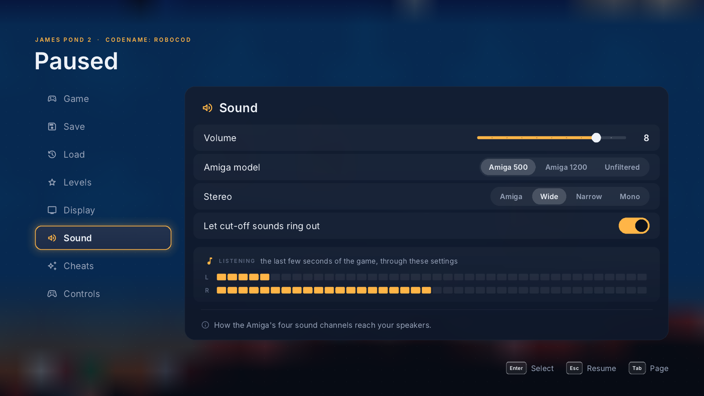 |
| 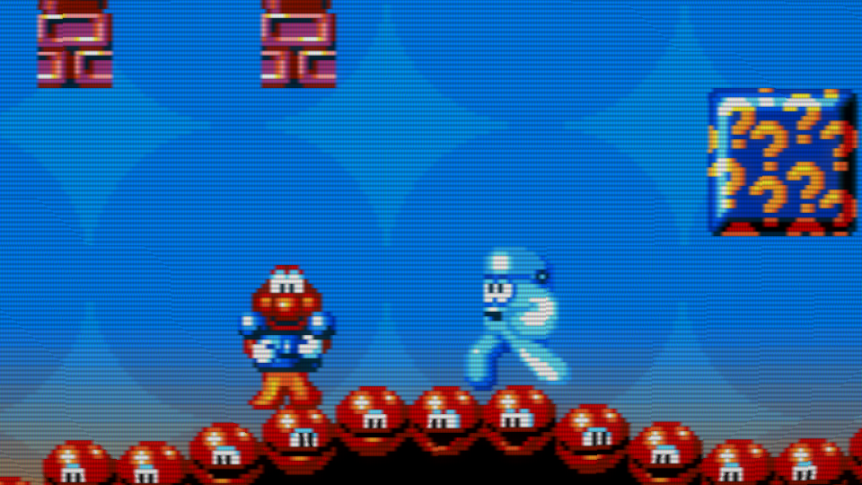 | 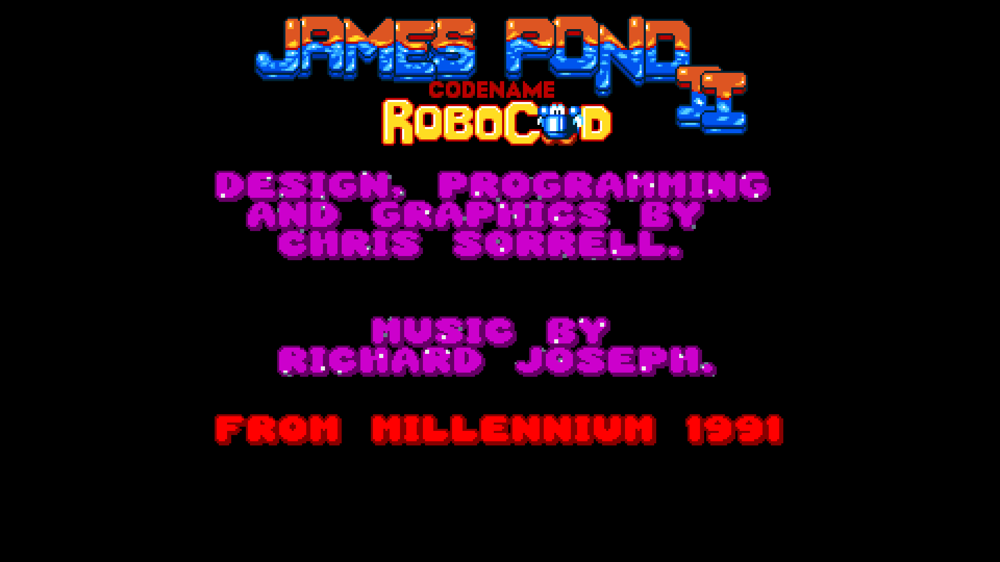 |

## What you need

- **Your own disk image** of the Amiga game. These work:
  - an `.adf` disk image of the **Kixx** re-release or one of the common
    cracked disks (for example Skid Row's);
  - the same packed as `.adz` (gzip) or inside a `.zip`;
  - a **WHDLoad** install folder of the game.

  These don't, yet: the **original Millennium** release, raw-track
  ("extended ADF") dumps of the copy-protected disk, `.dms` and `.ipf`
  images. The game tells you which you have; see [Help](#help).
- For the PlayStation 5: a console that runs homebrew, with an FTP server and
  a way to register a title folder (ShadowMountPlus, for example).

## Install

### Windows

1. Download `JamesPond2-Windows-<version>.zip` from the
   [releases](https://github.com/griches/JamesPond2RobocodRecomp/releases) and
   unzip it anywhere, for example into `Documents`.
2. Open the `JamesPond2` folder and start **James Pond 2.exe**.
3. The first time, the game asks for your disk. It lists any it finds in your
   Downloads, Desktop and Documents folders; choose one, choose
   **Choose a disk image…** to pick it yourself, or drop the file on the
   window. The disk is copied into the game's own folder, so this happens
   only once.

Needs 64-bit Windows 10 or 11. If Windows SmartScreen warns about an unknown
app, choose **More info**, then **Run anyway**.

### macOS

1. Download `JamesPond2-macOS-<version>.zip` from the
   [releases](https://github.com/griches/JamesPond2RobocodRecomp/releases) and unzip it.
2. Move **James Pond 2.app** to your Applications folder and open it.
3. The first time, the game asks for your disk. It lists any it finds in
   your Downloads, Desktop and Documents folders; choose one, choose
   **Choose a disk image…** to pick it yourself, or drop the file on the
   window. The disk is copied into the game's own folder, so this happens
   only once.

Needs macOS 13 or later, on Apple silicon or Intel.

### Steam Deck

1. In Desktop Mode, download `JamesPond2-Linux-<version>.tar.gz` from the
   [releases](https://github.com/griches/JamesPond2RobocodRecomp/releases) and unpack it into a folder of your choice,
   for example `~/Games/JamesPond2`.
2. Put your disk image next to `jp2` and name it `jp2.adf`, or leave it
   anywhere and choose it on the first start: the game looks in your
   Downloads, Desktop and Documents, EmuDeck's Amiga folders and SD cards.
3. In Steam, choose **Add a Game → Add a Non-Steam Game…**, browse to the
   folder and add `run.sh`. Rename the entry *James Pond 2* if you like.
4. Back in Game Mode, start it from your library. The Deck's buttons are
   shown in the menus, and the picture fills the Deck's 16:10 screen.

If the Deck's controls don't respond, set the game's controller layout in
Steam to **Gamepad**.

### Linux

As for the Steam Deck: unpack `JamesPond2-Linux-<version>.tar.gz` and run
`./jp2` (or `./run.sh` for full screen). The program needs only the C
library, so it runs on most 64-bit x86 distributions.

### PlayStation 5

1. Download `JamesPond2-PS5-<version>.zip` from the
   [releases](https://github.com/griches/JamesPond2RobocodRecomp/releases) and unzip it. You get a `PPSA99323` folder.
2. Copy the whole `PPSA99323` folder to `/data/homebrew/` on the console over
   FTP.
3. Copy your disk image into `/data/homebrew/PPSA99323/`. Any file name works.
4. Register the title (ShadowMountPlus does this when it scans
   `/data/homebrew`) and start **James Pond 2: Codename RoboCod** from the home
   screen. It plays from your disk straight away; there's nothing to unpack or
   prepare first.

If you start it before the disk is there, it shows where the disk goes.
Copy it in, then choose **Look again**.

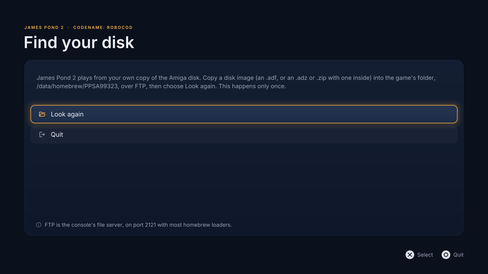

The game runs at 4K. Saves and settings stay in the title's folder, so keep
`userdata/` if you reinstall.

## Controls

| Action | Controller | Keyboard |
|---|---|---|
| Move | D-pad or left stick | Arrow keys |
| Jump | A (✕) | ↑ |
| Stretch up | B or X (○ or □) | Space or Right Ctrl |
| Quick save / quick load | L1 / R1 | F5 / F8 (or 1 / 2) |
| Smooth motion on or off | Y (△) | 4 |
| Widescreen on or off | | 3 |
| Menu | Menu or View (Options or Create) | Esc |

On the Amiga, pushing the joystick up also jumped. That's off by default so
the stick can't jump by accident; turn on **Up also jumps** in the Controls
menu to get it back.

Hold down while you fall to curl up into a ball: that's how Robocod squashes
enemies and bosses, as in the original.

In the menu: move with the D-pad or arrow keys, choose with A (✕) or Enter, go
back with B (○) or Esc, and change page with L1 / R1 or Tab.

## The menu

Press Menu (Options on a PlayStation controller) or Esc at any time.

| Page | What it has |
|---|---|
| **Game** | Resume, quit to the title screen, quit the game; your score, lives and energy |
| **Save** | The quick slot and three slots, each with a picture and the time it was saved |
| **Load** | The same slots, to load from |
| **Levels** | Any level of any world; *Play this level* takes you there |
| **Display** | Widescreen, smooth motion, picture (crisp, pixel perfect, soft, CRT), scanlines, a frame rate counter, full screen |
| **Sound** | Volume, Amiga model (Amiga 500, Amiga 1200, unfiltered), stereo width, let cut-off sounds ring out |
| **Cheats** | Invincible, infinite lives, wings, skip to the exit |
| **Controls** | Up also jumps, rumble strength (off, 1–10), and every button and key |

While a Display setting is selected, the menu fades so you can see the change
on the game itself. On the Sound page, the last few seconds of the game play
again through the settings you choose.

## Saves and settings

Everything the game keeps is in one folder:

| System | Folder |
|---|---|
| Windows | `%APPDATA%\bouncingball\James Pond 2\` |
| macOS | `~/Library/Application Support/bouncingball/James Pond 2/` |
| Steam Deck and Linux | `~/.local/share/bouncingball/James Pond 2/` |
| PlayStation 5 | `/data/homebrew/PPSA99323/userdata/bouncingball/James Pond 2/` |

- `quicksave.jp2s`, `slot1.jp2s` … `slot3.jp2s`: your saves (the `.thumb`
  files beside them are their pictures);
- `resume.jp2s`: where you were when you last quit in the middle of a level;
- `settings.ini`: your menu settings;
- `disk.adf`: the copy of your disk the game plays from (Windows, macOS, Linux).

Saves belong to your disk: a save made with one release of the game won't load
with another.

## Help

**The game says my disk isn't supported.** It names what it found:

| Message | What to do |
|---|---|
| *the original Millennium release, which isn't supported yet* | Use the Kixx re-release, its WHDLoad install or a cracked disk |
| *a raw-track image (extended ADF)* | Use a standard `.adf` of a cracked or Kixx disk |
| *DMS images aren't supported* | Turn it into an ADF first; xDMS or WinUAE can |
| *IPF images aren't supported* | Use a standard `.adf` |
| *that's an LHA archive* | Unpack it and choose the folder (a WHDLoad install) |
| *this isn't the Amiga (OCS) James Pond 2 disk* | The file is another game, or another machine's version |

**I want to use a different disk.** Delete `disk.adf` from the saves folder
(above) and start the game again; it asks for one.

**Windows says it protected your PC.** That's SmartScreen, which warns about
programs it hasn't seen often. Choose **More info**, then **Run anyway**.

**The picture is too sharp, or too soft.** Try the other **Picture** settings
in the Display menu. *Pixel perfect* keeps every pixel the same size; *CRT*
looks like an old television.

**Scrolling stutters.** Make sure **Smooth motion** is on (Display menu, or
press Y / 4). The frame rate counter in the Display menu shows what your
display is getting.

**The music sounds muffled.** That's the Amiga 500's filter, as most people
heard the game. Choose **Amiga 1200** or **Unfiltered** in the Sound menu for
a brighter sound.

**Robocod can't go back left through some tubes.** That's the original game:
some of the narrow sloping tubes only let him through in one direction.

**PlayStation 5: the title doesn't show on the home screen.** Run
ShadowMountPlus's scan again, or restart the console with the folder in
`/data/homebrew/`.

**PlayStation 5: the game can't find the disk.** It must be directly in
`/data/homebrew/PPSA99323/` (or one folder below it), as an `.adf`, `.adz`
or `.zip`.

## Building from source

See [docs/BUILDING.md](docs/BUILDING.md). In short: the recompiler reads your
disk image and writes the game's code as C++, which is then compiled with the
runtime (the Amiga's custom chips, sound and the new features) against SDL3.
The generated code is made from your disk on your machine and is never part
of this repository.

## Credits and licences

*James Pond 2: Codename RoboCod* was designed, programmed and drawn by Chris
Sorrell, with music by Richard Joseph, and published by Millennium in 1991.
This project is not affiliated with or endorsed by its rights holders, and
contains none of the game: you play it from your own copy.

Built with:

- [SDL3](https://libsdl.org) (zlib licence)
- [Musashi](https://github.com/kstenerud/Musashi), Karl Stenerud's 68000
  emulator, for code the recompiler hasn't translated (MIT licence)
- [stb_truetype](https://github.com/nothings/stb) (public domain)
- [puff](https://github.com/madler/zlib/tree/develop/contrib/puff), Mark
  Adler's inflater, for zipped disks (zlib licence)
- [Inter](https://rsms.me/inter/) (SIL Open Font License) and
  [Material Symbols](https://fonts.google.com/icons) (Apache 2.0) in the menus
- On the PlayStation 5: PS5_Vulkan and Mesa's RADV for the graphics

Their licence texts are in `vendor/`, `res/fonts/`, and beside the program in
each release.

This project's own code is licensed under the
[GNU General Public License v3.0](LICENSE).
